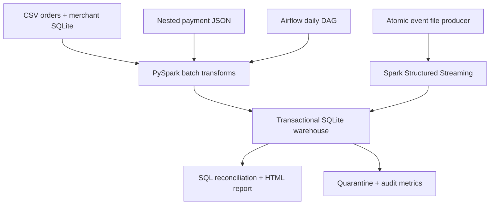

# FlowLedger
### An auditable payment reconciliation pipeline — Python · SQL · PySpark · Airflow

A useful data engineering portfolio lab: combine merchant records from a relational source,
orders from CSV, and nested payment JSON events to identify **unpaid orders, failed payments,
and payment mismatches**. Dirty records are quarantined, duplicates never increase revenue,
and successful microbatches are committed with an audit trail.

**This is a runnable, AI-assisted project starter, not a certification of its owner's experience.**
Run it, inspect the evidence, complete the exercises, and explain your changes before claiming
hands-on ownership. All example records are synthetic. No payment gateway credentials needed.

## Start here (Windows, macOS or Linux)

Easiest complete stack: Docker Desktop with Compose v2 (WSL2 backend on Windows).
Allow roughly 6–8 GB of Docker memory and several GB of disk space; actual needs vary.
From this extracted folder:

```bash
docker compose up --build -d
docker compose logs -f airflow
```
Wait for Airflow's login details; press Ctrl+C to stop following logs (service keeps running).
Open http://localhost:8080 and use the generated admin credentials from the logs.
Then run these commands in your terminal:

```bash
docker compose exec airflow python -m flowledger generate --orders 1000
docker compose exec airflow python -m flowledger batch
docker compose exec airflow python -m flowledger check
docker compose exec airflow python -m flowledger report
docker compose cp airflow:/opt/flowledger/data/reports ./reports
```
Open `reports/dashboard.html` by double-clicking. It is an offline, searchable snapshot of
actual warehouse data. It shows revenue, rejected records, reconciliation exceptions, and runs.
Rerun `report` and the copy command after processing new data.

To demonstrate **Airflow**, trigger `flowledger_reconciliation` in its UI, or run:

```bash
docker compose exec airflow airflow dags trigger flowledger_reconciliation
docker compose exec airflow airflow dags unpause flowledger_reconciliation
```
The graph has three real tasks: **batch_transform_and_load → validate_warehouse → publish_metrics**.
Tasks retry twice. Daily scheduling is a lab configuration: source files are staged separately,
and unchanged snapshots are recognized as replays. There is no implied external daily feed.
`max_active_runs=1` prevents overlapping DAG runs. Airflow does not schedule an endless stream.

### Demonstrate near-real-time ingestion

Terminal A (leave running):
```bash
docker compose exec airflow python -m flowledger stream
```
Terminal B:
```bash
docker compose exec airflow python -m flowledger emit --count 5 --interval 2
docker compose exec airflow python -m flowledger report
```
The producer writes one complete file atomically every two seconds. Spark checks for new
files with a five-second processing-time trigger. That is a trigger interval, **not a latency SLA**.
Wait for commits in Terminal A before regenerating the report. Stop Terminal A with Ctrl+C.
For a bounded, repeatable streaming demo, emit first and run `stream --once`; it processes
available files and exits. Repeating it with the same checkpoint must not inflate totals.

### Stop and resume
```bash
docker compose stop
docker compose start
```
Named volumes preserve your data, checkpoint and Airflow state. `docker compose down` also
preserves named volumes; **do not add `-v` unless intentionally deleting the entire lab**.
Run generation only once per root. Rerunning it refuses to overwrite existing sources.

## Run without Docker (tested path)

Use Python 3.11 or 3.12 and Java 17. Windows: use Ubuntu under WSL2 for Spark;
Airflow's local development path also belongs in Linux/WSL2. In a terminal inside this folder:

```bash
python -m venv .venv
source .venv/bin/activate
pip install -r requirements.txt
python -m flowledger generate --orders 1000
python -m flowledger batch
python -m flowledger check
python -m flowledger emit --count 5 --interval 0
python -m flowledger stream --once
python -m flowledger report
python -m pytest -q
python scripts/verify_end_to_end.py
python scripts/query.py --root data
```
Java must be on PATH; check `java -version`. `JAVA_HOME`, if set, must point to Java 17.
`requirements.txt` does not install Airflow; use Docker for its UI and scheduler.
All CLI commands support `--root` **before** the subcommand, e.g.
`python -m flowledger --root experiment1 generate --orders 10000`.

The verification script launches separate Python processes to test persistence and retry behavior,
uses a temporary dataset, and writes `evidence/user_verification.json`. It may take a few minutes.

## What the default batch should show

| Measure | Expected |
|---|---:|
| Orders | 1,000 |
| Input payment rows | 914 |
| Unique valid payment events | 900 |
| Duplicate events | 10 |
| Rejected records | 4 |

Rejects cover malformed JSON, an invalid timestamp, a negative amount, and an unknown order.
Additional tests cover currency/status errors, conflicting event IDs, late data, quality-gate
rollback, interrupted commits and immutable reference records. A fresh five-event producer run
increases payments from 900 to 905. Calling `emit` again creates new payment attempts, not retries;
it may intentionally overpay those orders. Copying an old event tests duplicate delivery instead.

## Architecture



`data/bronze/` stores content-addressed copies of processed raw sources. PySpark is the
validation/transformation layer. `fact_order`, `fact_payment` and `dim_merchant` form the modeled
serving layer. SQL views compute reconciliation and event-date revenue. This is not a distributed
lakehouse: SQLite is a deliberate laptop-friendly sink, and the driver writes records serially.

## Project map

| Location | What to inspect |
|---|---|
| `flowledger/generate.py` | Reproducible sources, dirty records, atomic event producer |
| `flowledger/pipeline.py` | Explicit Spark schemas, JSON parsing, normalization, broadcast join, streaming |
| `flowledger/warehouse.py` | Transactions, deduplication, audit ledger, rollback, failure logs |
| `sql/schema.sql` | Keys, constraints, star-like fact/dimension model and views |
| `sql/analytics.sql` | Joins, CTEs, ranking, running totals and operational metrics |
| `dags/flowledger_dag.py` | Real orchestration, dependencies, retries and timeout |
| `tests/` | Data correctness, recovery, replay and Spark transformation tests |
| `evidence/` | Results recorded during creation; not a substitute for your own run |
| `docs/JD_COVERAGE.md` | Every JD requirement mapped to implementation and proof |
| `docs/LEARNING_GUIDE.md` | Beginner explanation, interview walkthrough and ownership exercises |
| `docs/RUNBOOK.md` | Failure recovery, contracts, limits and troubleshooting |
| `docs/VERIFICATION.md` | Precisely what was and was not executed |

## Design guarantees and limits

- One event ID identifies one immutable payment attempt. Identical redeliveries are ignored.
  Conflicting reuse is rejected; the first committed version remains authoritative.
- Sink transactions atomically commit accepted rows, rejects and a run ledger. Replaying the
  same run returns its previous result. A crash before commit leaves none of these partial writes.
- Keep the warehouse and streaming checkpoint together. Never delete only the checkpoint:
  microbatch IDs restart at zero and can collide with the committed-run ledger.
- Late events are accepted and recompute event-date SQL views. This ledger has **no watermark**
  and makes no claim of bounded state or a late-event discard window.
- A reject ratio above 20% fails the entire sink batch; normal small reject volumes are quarantined.
  Rejected ratio uses all input rows, including duplicates. Failed-batch quarantine is rolled back;
  inspect immutable raw inputs and `data/failures/` for those failures.
- Source contracts are in `docs/RUNBOOK.md`. Reference tables are immutable and loaded before
  payment processing. A rejected payment batch can leave valid reference tables loaded; this is
  intentionally not a distributed transaction across input phases.
- Event producer + file source is genuine Spark Structured Streaming, not Kafka or CDC.
  SQLite, local file storage and Airflow standalone are for a single-machine lab, not production.
- No fabricated million-row benchmark, cloud deployment, uptime or business-impact claims.

## Source references and version choices

Pinned teaching baseline: Spark 3.5.7, Airflow 2.10.5, Java 17; these are **not claims of latest versions**.
Consult official guidance before upgrading:
- https://spark.apache.org/docs/3.5.7/structured-streaming-programming-guide.html
- https://airflow.apache.org/docs/apache-airflow/2.10.5/start.html

Spark's `foreachBatch` sink needs application-level replay handling; this project's transactional
ledger and event keys implement it for this specific local sink. Airflow standalone is explicitly
a development setup. See the runbook for a production migration plan.
